# ⚡ OpsWingman — Operations Control Center

[](https://www.python.org/)
[](https://fastapi.tiangolo.com/)
[](https://nextjs.org/)
[](https://www.typescriptlang.org/)
[](https://www.postgresql.org/)
[](https://www.docker.com/)
[](https://docs.pytest.org/)
[](https://github.com/astral-sh/ruff)
[](LICENSE)

> **Deterministic Runtime & Intelligent Operations Control Center for Modern Commerce**  
> An enterprise-grade operations platform for e-commerce, retail, and logistics. OpsWingman unifies orders, payments, logistics, and customer support into an intelligent control center — **keeping policy enforcement, risk scoring, financial authorization, and database truth strictly outside the LLM**.

---

## 💡 The "Why": Why Was There a Need to Build OpsWingman?

### The Problem in Modern Digital Commerce
Running modern commerce operations is notoriously chaotic:
1. **Fragmented Silos:** Customer data lives in Shopify or Salesforce, payments in Razorpay or Stripe, packages with BlueDart or Delhivery, and customer complaints in Zendesk or Freshdesk. Operations staff spend up to 40% of their workday copying tracking IDs and cross-checking order statuses across 5 different browser tabs.
2. **The Fatal Danger of "AI Chatbots":** When companies attempt to automate operations using generic AI agents or chatbots, disasters quickly follow. Unchecked LLMs hallucinate non-existent tracking numbers, promise unauthorized customer refunds, cancel orders that have already been loaded onto delivery trucks, and write erroneous mutations directly to operational databases.
3. **Financial and Legal Risk:** Issuing an unapproved ₹10,000 refund or violating carrier cancellation policies directly erodes company margins. Businesses cannot afford "probabilistic" gambles with real money, inventory, and customer trust.

### The Solution: The Deterministic Operations Plane
**OpsWingman was created to solve this architectural problem permanently.**

We established a fundamental rule: **AI models should propose actions, but deterministic software code must decide.**

```
┌───────────────────────────────────────────────────────────────────────────┐
│                       THE CORE ARCHITECTURAL LAW                          │
│                                                                           │
│   The AI proposes actions; deterministic software boundaries decide.      │
│   The AI must NEVER directly control authorization, payment capture,      │
│       refunds, credentials, database truth, or supervisor approvals.      │
└───────────────────────────────────────────────────────────────────────────┘
```

OpsWingman treats the AI as an intelligent co-pilot for reasoning and drafting, while wrapping every execution in:
* **Deterministic Policy Engine:** Enforces business rules (e.g., *Refunds > ₹5,000 must be approved by a supervisor*).
* **Machine Learning Risk Scoring:** Calculates real-time anomaly scores before any sensitive action is taken.
* **Human-in-the-Loop Gating:** Automatically pauses high-risk workflows in an executive Approval Queue.
* **Two-Phase State Verification:** Directly queries the database after tool execution to detect and prevent "ghost successes" (where an API reports success but the database was never mutated).
* **Immutable Audit Ledger:** Cryptographically records every intent, policy citation, supervisor decision, and database mutation.

---

## 🌟 Key Benefits

### 👔 For Business Leaders & Executives
* **Zero Financial Leakage:** Hard limits stop unauthorized refunds and illegitimate SLA compensation.
* **100% Policy Compliance:** Every operational action is checked against official company policies (with exact chapter-and-verse citations).
* **Complete Visibility:** Real-time telemetry on revenue velocity (MTD/Today), logistics delays, and customer dispute health.

### ⚙️ For Operations & Support Managers
* **Single Pane of Glass:** Orders, payments, shipments, and customer tickets unified in one high-performance interface.
* **Proactive Exception Management:** Automated alerts for courier hub delays, card timeouts, and SLA breaches before customers complain.
* **Human-in-the-Loop Approvals:** Review and authorize high-risk AI proposals with one click, accompanied by retrieved policy citations.

### 🛡️ For Engineers & Compliance Officers
* **Deterministic Runtime:** Typed Pydantic schemas, idempotent tool execution, and isolated transactional boundaries.
* **Ghost-Success Immunity:** Built-in verification engine ensures that an order is only marked refunded or cancelled if the physical database confirms the state transition.
* **Tamper-Evident Audit Trail:** Full provenance logging for security certifications (SOC 2, ISO 27001).

---

## 🧭 How the User Will Use OpsWingman (Workflows & User Journeys)

### Workflow 1: The Daily Operational Morning Routine
How an operations lead uses OpsWingman to start their business day:

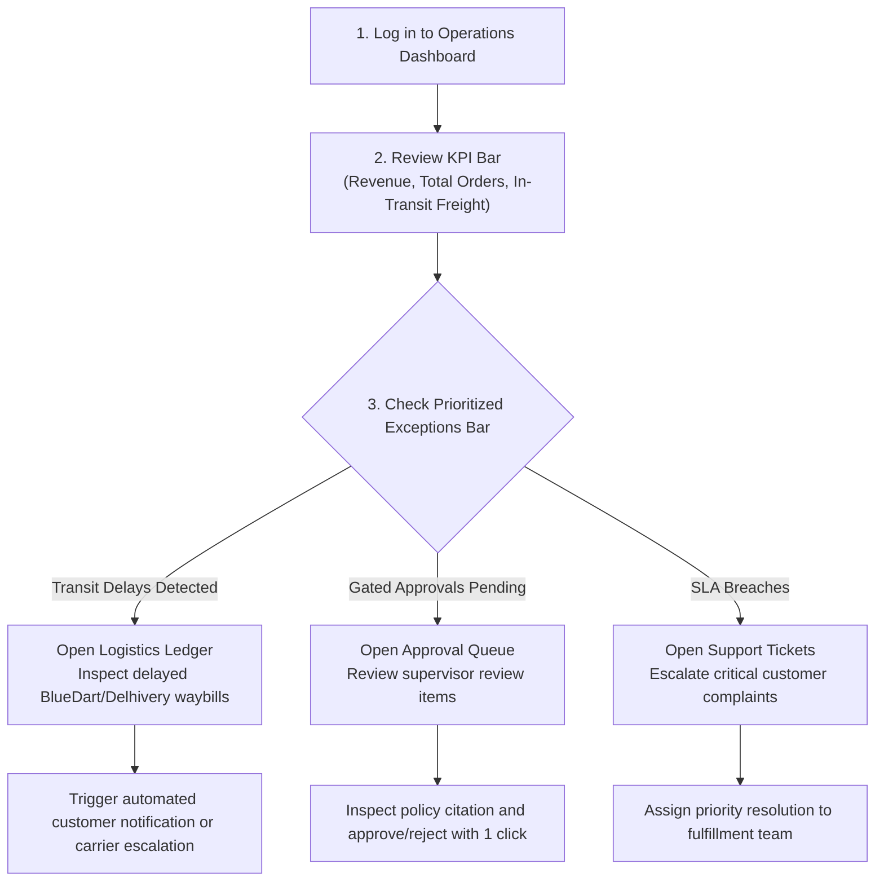

---

### Workflow 2: AI-Powered Customer Resolution with Human Safety Gate
How a high-value customer request is processed with deterministic safety:

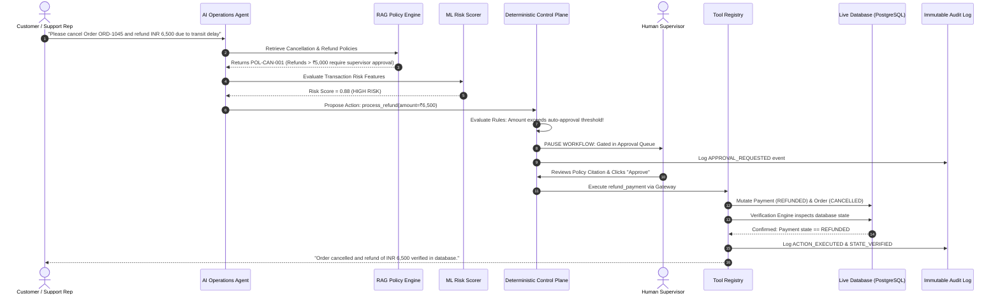

---

### Workflow 3: Customer 360° Profile & Lifetime Activity Investigation
How a support agent researches customer history to make informed decisions:

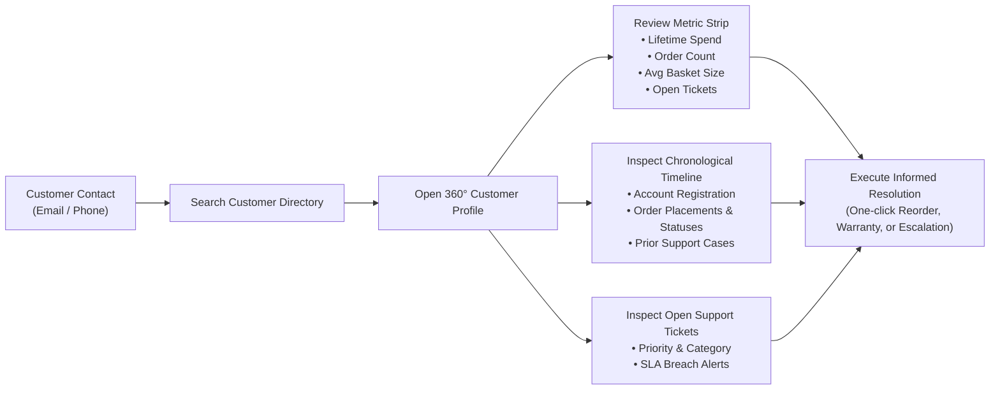

---

## 🖥️ Interactive Tour: The Operations Control Center

Here is the actual OpsWingman platform in action, designed with an information-dense, high-contrast dark aesthetic inspired by Linear and Stripe Dashboard.

### 1. Operations Overview Dashboard (`/`)
The executive single-pane-of-glass displaying real-time revenue velocity, order lifecycle distribution, active freight in-transit, and payment channels:

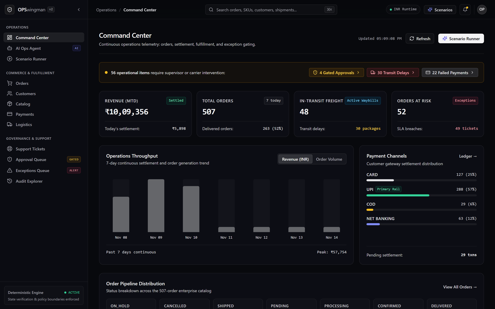

* **Revenue Velocity (MTD):** Live settlement totals (₹10,09,356.38) and today's settlement (₹5,897.64).
* **Pipeline Telemetry:** 507 orders tracked across Delivered (263), Shipped (78), Processing (46), Confirmed (36), and Cancelled (41).
* **Payment Rails:** Real-time distribution showing UPI as the primary transaction rail (288 payments, 57% share) alongside Cards, Net Banking, and COD.
* **Proactive Exceptions Strip:** Highlights transit delays, pending approvals, and payment timeouts in real time.

---

### 2. Gated Human-in-the-Loop Governance Queue (`/approvals`)
The supervisor authorization queue where every high-risk or policy-restricted proposal is paused until an authorized human signs off:

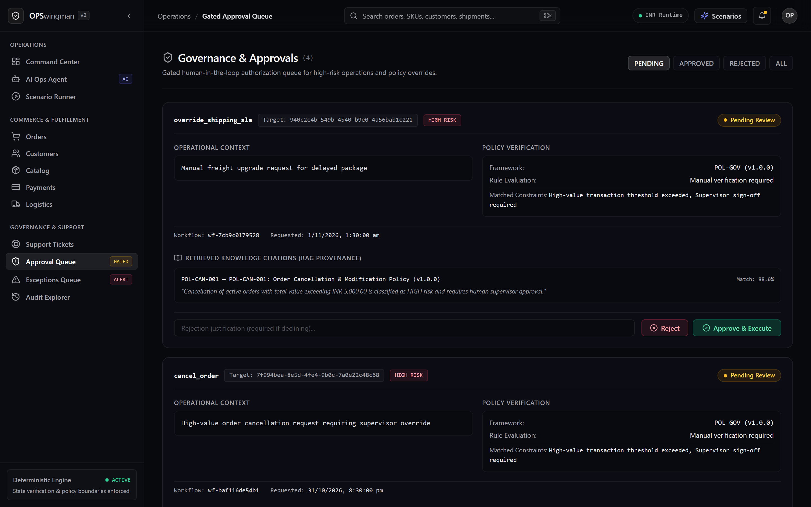

* **Deterministic Context:** Displays the exact action name, target order, and parameter details.
* **Policy Provenance (RAG Citations):** Surfaces the exact policy document (e.g., `POL-CAN-001: Order Cancellation & Modification Policy`) with chunk text and similarity scores so supervisors don't have to guess.
* **One-Click Authorization:** Supervisors can approve or reject proposals with full attribution recorded in the audit trail.

---

### 3. 360° Customer Profile & Unified Activity Timeline (`/customers/[id]`)
A comprehensive customer view uniting contact details, lifetime spend, support tickets, and an end-to-end chronological activity timeline:

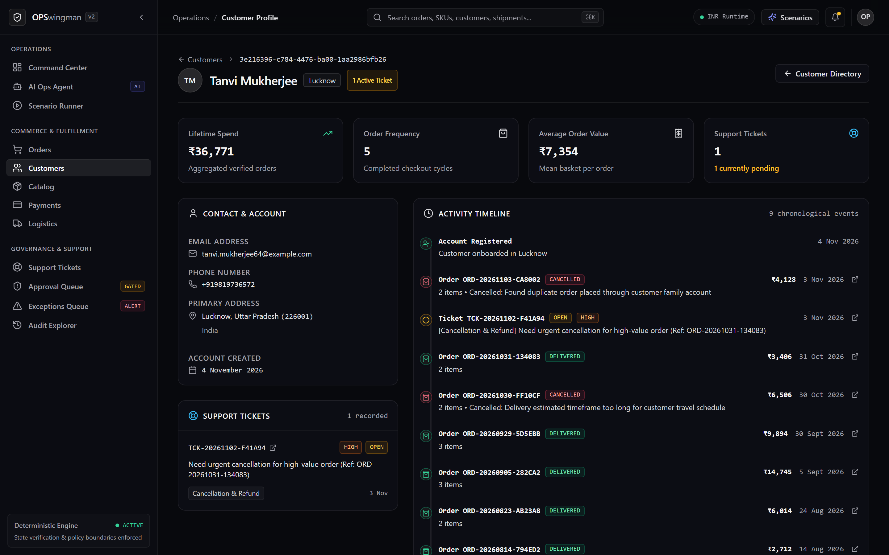

* **Executive Metrics:** Lifetime spend (e.g., ₹36,771), order frequency, and mean order basket value.
* **Unified Activity Timeline:** Merges customer registration, completed orders, cancellations, and support ticket submissions into a single chronological vertical feed.
* **Support Ticket History:** Shows ticket priority, status, category (e.g., *Cancellation & Refund*), and direct links to issue details.

---

### 4. Orders Ledger & Real-Time Tracking (`/orders`)
The operational order book with multi-parameter filtering, settlement method indicators, and courier dispatch data:

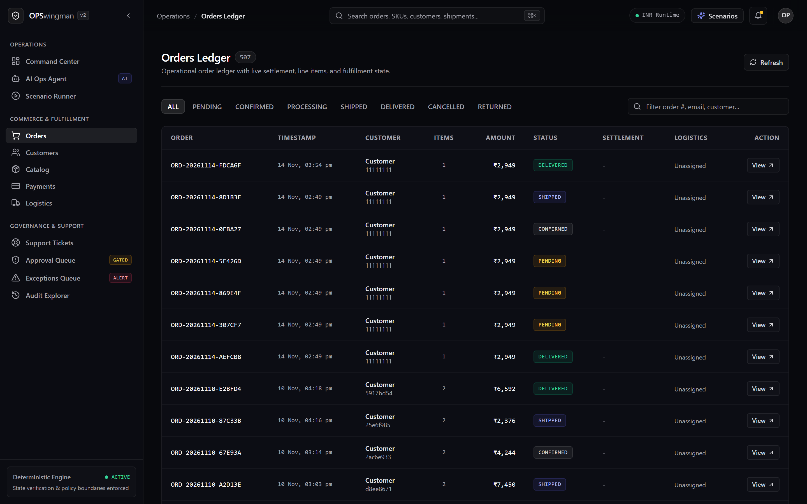

* **Real-Time Status Tags:** High-contrast tags for Delivered, Shipped, Processing, Pending, and Cancelled.
* **Fulfillment Metadata:** Real-time courier assignments (BlueDart, Delhivery, DTDC, Xpressbees) and waybill tracking numbers.

---

### 5. Detailed Order Financial Breakdown & State Machine (`/orders/[id]`)
An in-depth breakdown of a single order showing line items, GST taxation, fulfillment waybills, and deterministic cancellation controls:

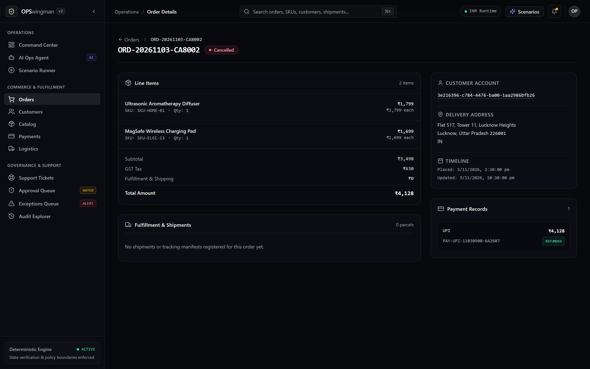

* **Financial Ledger:** Subtotal, GST Tax, Shipping Fee, and Applied Promotional Discounts.
* **State Machine Protection:** Cancellation actions trigger automated state machine validation; once an order enters carrier dispatch lock, supervisor intervention is strictly required.

---

### 6. Autonomous Operations Agent Console (`/agent`)
Interactive console where natural language instructions are parsed into structured execution graphs:

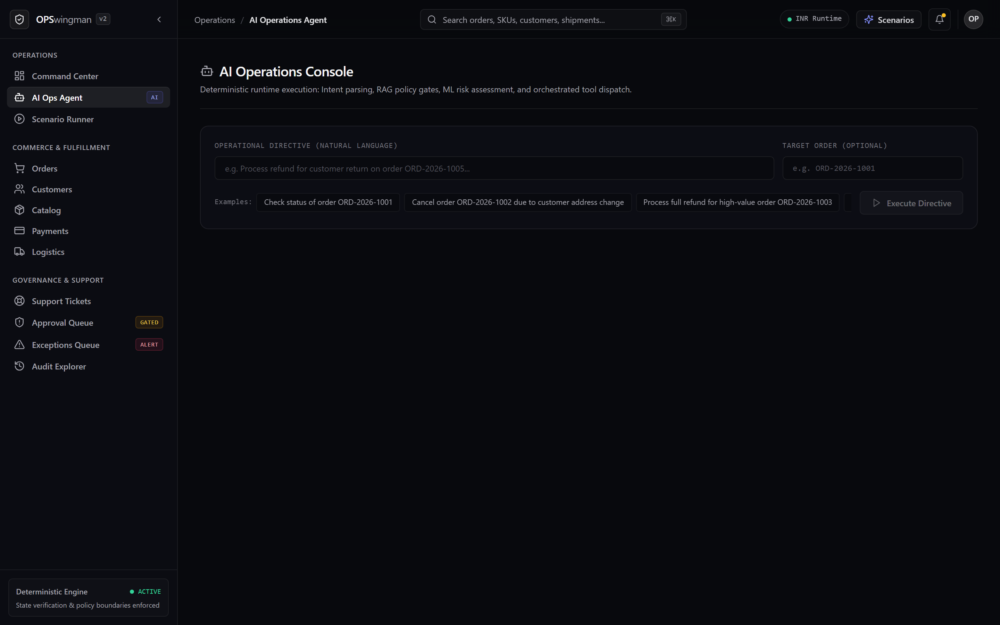

* **Intent Extraction:** Translates free-form instructions into structured, typed intents.
* **Live Step-by-Step Telemetry:** Visually tracks tool dispatch, latency, and policy evaluations.
* **Sample Scenario Directives:** Pre-configured directives to test order tracking, cancellations, and refunds.

---

### 7. Logistics & Carrier Waybills (`/shipments`)
Fleet logistics tracking with automated carrier SLA delay detection:

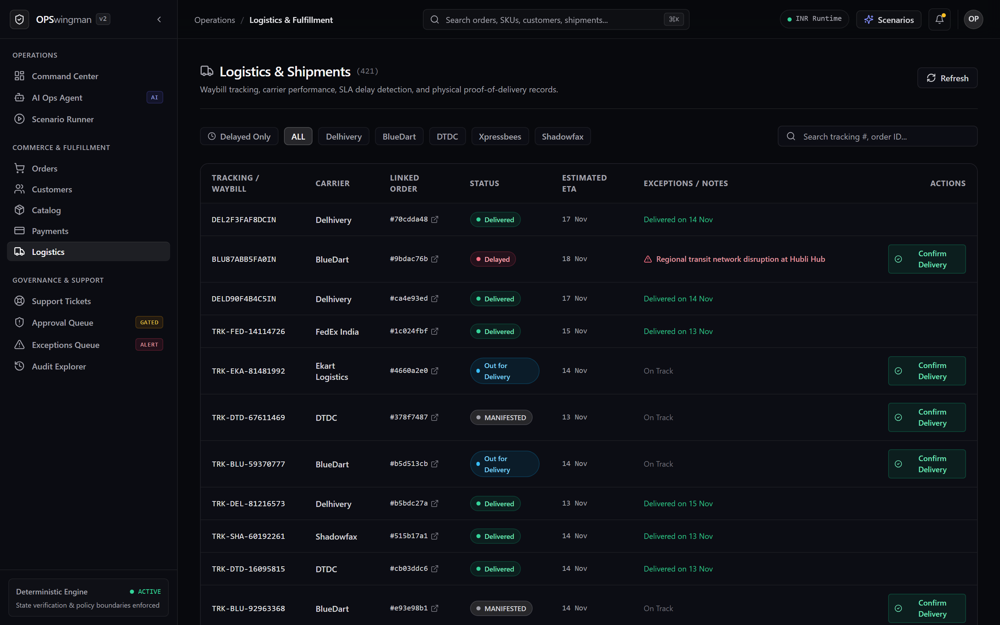

* **Carrier Performance:** Tracks on-time delivery percentages across BlueDart, Delhivery, DTDC, and Xpressbees.
* **Delay Detection:** Automatically flags packages stalled at transit hubs beyond 48 hours.

---

### 8. Operations Scenario Runner (`/scenarios`)
A built-in testing suite to simulate and verify 7 ground-truth business scenarios against the live database:

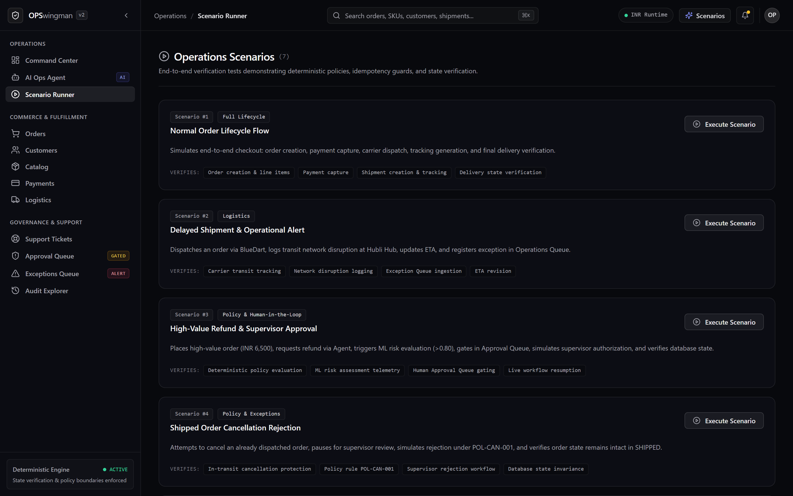

---

## 🧩 "What Was Used": Technology Stack Explained Simply

To help everyone from business leaders to senior software engineers understand the system, here is how OpsWingman is built:

| Component Role | Simple Analogy (Non-Technical) | Technology Used | Technical Specification & Purpose |
|:---|:---|:---|:---|
| **The Face** | The cockpit and visual screens used by the team | **Next.js 14 + Tailwind CSS** | Server-rendered React App Router, high-density dark UI, zero-lag client navigation, and responsive typography. |
| **The Brain** | The smart assistant that understands plain language | **FastAPI + Ollama / Gemini** | High-speed Python asynchronous API server coupled with structured JSON intent extraction. |
| **The Rulebook** | The official company policy handbook | **PostgreSQL + `pgvector`** | Vector database storing SOPs and policy embeddings for semantic similarity search (RAG). |
| **The Safety Guard** | The security guard that stops risky actions | **Pydantic v2 + ML Risk Model** | Deterministic validation schemas and isolation-forest risk scoring that enforce hard business rules. |
| **The Hands** | The workers that carry out actions | **Typed Tool Registry** | Strictly typed, idempotent Python functions that execute order cancellations, refunds, and carrier dispatches. |
| **The Ground Truth** | The permanent filing cabinet that never lies | **PostgreSQL 16** | Relational transactional database storing normalized customer, order, payment, and shipment tables. |
| **The Queue & Cache**| The high-speed clipboard for background tasks | **Valkey 7.2 (Redis-compatible)** | In-memory key-value store for asynchronous worker queues, idempotency locking, and caching. |
| **The Watchdog** | The security camera recording every move | **OpenTelemetry + Langfuse** | Append-only audit logging and distributed tracing tracking every model inference and database write. |

---

## 🏛️ Comprehensive System Architecture

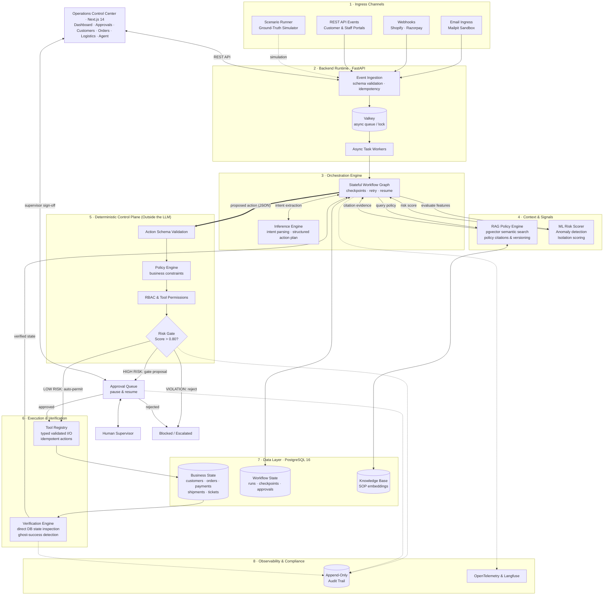

---

## 🧪 Operational Scenario Matrix (7 Ground-Truth Scenarios)

The built-in Scenario Runner (`/scenarios`) verifies all 7 core operational scenarios against live database state:

| ID | Scenario Name | Category | Tested Architectural Mechanisms |
|:---|:---|:---|:---|
| **1** | **Normal Order Lifecycle Flow** | Full Lifecycle | Order creation, payment capture, carrier dispatch, tracking generation, delivery verification |
| **2** | **Delayed Shipment & Exception** | Logistics | Transit disruption logging, revised ETA, automatic exception creation in Control Center |
| **3** | **High-Value Refund & Approval** | Policy & Human Review | Deterministic policy evaluation, ML risk gating (>0.80), supervisor approval, resume workflow |
| **4** | **Shipped Order Cancellation Rejection** | Policy Invariance | In-transit cancellation protection under POL-CAN-001, supervisor rejection, database invariance |
| **5** | **Duplicate Request Protection** | Idempotency | Idempotency cache layer, distributed lock guard, replay cache, zero duplicate mutations |
| **6** | **Payment Failure & Safe State** | Gateway Integration | Gateway issuer decline, safe invariant check (order stays PENDING, never marked CONFIRMED) |
| **7** | **Verification Divergence Detection** | State Verification | Ghost-success detection, tool-vs-DB discrepancy analysis, automated operational alert |

---

## 📦 Enterprise Synthetic Dataset

OpsWingman includes a production-scale synthetic business dataset representing an active Indian e-commerce merchant:

| Entity | Volume | Characteristics |
|:---|---:|:---|
| **Customers** | **150** | Verified accounts across Mumbai, Bengaluru, Delhi, Pune, Hyderabad, Lucknow |
| **Products** | **80** | Electronics, apparel, home appliances priced in Indian Rupees (₹199 – ₹24,999) |
| **Orders** | **507** | Distributed across `DELIVERED` (263), `SHIPPED` (78), `PROCESSING` (46), `CONFIRMED` (36), `CANCELLED` (41) |
| **Payments** | **507** | UPI (288, 57%), Card (127, 25%), Net Banking (63, 12%), COD (29, 6%) |
| **Shipments** | **400+** | Delhivery, BlueDart, DTDC, Xpressbees with real waybill tracking and hub delay logging |
| **Support Tickets** | **120** | Transit delays, cancellation requests, warranty claims with priority SLA tracking |
| **Approvals** | **55+** | Supervisor override records with RAG citations, risk bands, and decision timestamps |
| **Audit Events** | **1,600+** | Append-only event trail tagged with provenance metadata |
| **Knowledge Base** | **32** | Policies (cancellations, refunds, shipping SLAs), SOPs, and carrier guidelines |

---

## 🚀 Quick Start Guide

### 1. Prerequisites
* [Docker Desktop](https://www.docker.com/products/docker-desktop/) (Windows / macOS / Linux)
* [Python 3.12+](https://www.python.org/)
* [Node.js 20+](https://nodejs.org/)

### 2. Clone & Configure Environment
```bash
git clone https://github.com/your-username/opswingman.git
cd opswingman

# Copy default development environment file
cp .env.example .env
```

### 3. Launch with Docker Compose
The easiest way to launch the entire stack (PostgreSQL + pgvector, Valkey, Mailpit, Langfuse, Backend API, and Next.js Frontend):
```bash
docker compose up -d
```
All services will initialize automatically:
* **Operations Control Center (Frontend):** [http://localhost:3000](http://localhost:3000)
* **Backend API Documentation (Swagger):** [http://localhost:8000/docs](http://localhost:8000/docs)
* **Mailpit (Email Sandbox):** [http://localhost:8025](http://localhost:8025)
* **Langfuse (Tracing & Observability):** [http://localhost:3001](http://localhost:3001)

### 4. Running Backend Tests
To execute the comprehensive backend test suite (255 tests covering unit logic, security, seed hardening, and policy gates):
```bash
python -m pytest tests/unit -q
```
Expected output:
```
255 passed in ~60s (100% green)
```

### 5. Running Frontend Lint & Build
```bash
cd frontend
npm run lint    # 0 warnings, 0 errors
npm run build   # Compiles all 15 routes cleanly
```

---

## 🔒 Security & Safe Execution Invariants

1. **Deterministic Perimeter:** The AI model never receives payment gateway API keys or production database credentials. Actions are executed via typed Pydantic tools.
2. **Atomic Single-Transaction Control:** Enterprise seeding and operational workflows operate within single transactions. Intermediate steps flush without committing; any failure triggers a complete rollback.
3. **Environment Guards:** The database seeder refuses to execute against staging, production, or unapproved remote environments (`validate_database_safety`).
4. **Credential Leakage Prevention:** Passwords, API tokens, and secrets are sanitized from logs, traces, and error outputs.
5. **Safe Database Invariance:** Application rollbacks preserve database forward-compatibility without destructive rollbacks.

---

## 📄 License

OpsWingman is licensed under the [Apache 2.0 License](LICENSE).
