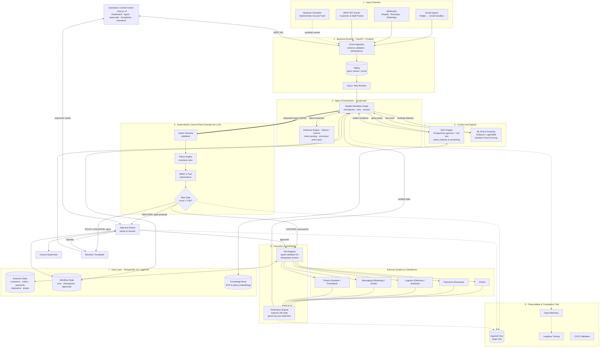
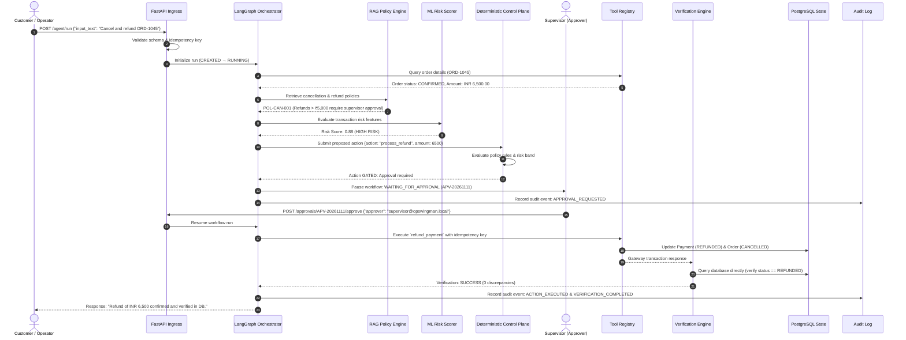
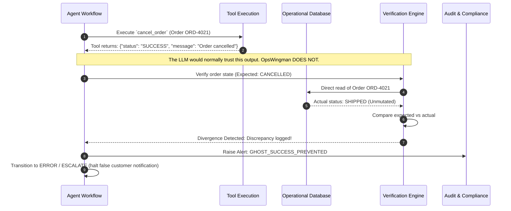
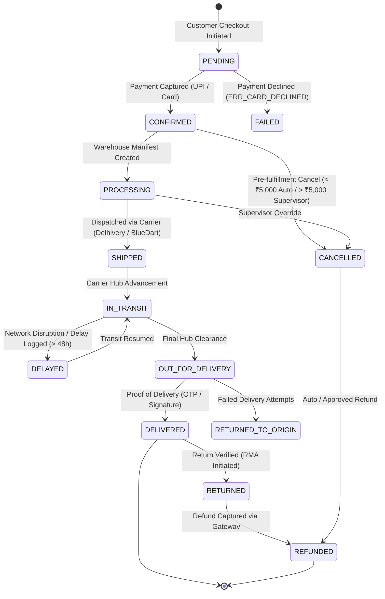

# OpsWingman — Operations Control Center

[](https://www.python.org/)
[](https://fastapi.tiangolo.com/)
[](https://nextjs.org/)
[](https://www.typescriptlang.org/)
[](https://www.postgresql.org/)
[](https://www.docker.com/)
[](https://docs.pytest.org/)
[](https://github.com/astral-sh/ruff)
[](LICENSE)

> **Deterministic Runtime & Enterprise AI Operations Control Center for Modern Commerce**
> A high-reliability operations execution platform for retail, e-commerce, and logistics. OpsWingman executes end-to-end customer workflows across orders, payments, fulfillment, and customer support — **keeping policy enforcement, risk scoring, financial authorization, state verification, and audit provenance strictly outside the LLM**.

---

## 🎯 Executive Overview

OpsWingman transforms modern business operations by providing a reliable execution layer for customer and order workflows. Unlike chat-based assistants or opaque autonomous agents, OpsWingman treats AI models purely as drafting and reasoning components governed by **deterministic application code**, **formal authorization boundaries**, and **human-in-the-loop review** for sensitive actions.

```
┌───────────────────────────────────────────────────────────────────────────┐
│                       THE CORE ARCHITECTURAL LAW                          │
│                                                                           │
│   The LLM proposes actions; deterministic software boundaries decide.     │
│   The LLM must NEVER directly control authorization, payment capture,     │
│       refunds, credentials, database truth, or supervisor approvals.      │
└───────────────────────────────────────────────────────────────────────────┘
```

---

## 🖥️ Operations Control Center — Visual Overview

OpsWingman provides a complete mission-control interface for operations teams, customer support leads, fulfillment managers, and compliance supervisors.

### 1. Operations Overview Dashboard (`/`)
Live operational telemetry displaying real-time metrics, financial velocity, fulfillment status, and exception distribution:

```
┌──────────────────────────────────────────────────────────────────────────────────────────────────┐
│  OPSWINGMAN  │  Dashboard  Orders  Customers  Payments  Logistics  Tickets  Agent  Approvals  Audit  │
├──────────────────────────────────────────────────────────────────────────────────────────────────┤
│                                                                                                  │
│  [ Total Orders ]       [ Today's Revenue ]      [ Delayed Shipments ]     [ Pending Approvals ] │
│     500 orders             ₹1,48,250                 38 shipments               12 requests      │
│     +18 today              Peak: ₹2,10,000           Transit Disruption         Supervisor Gated │
│                                                                                                  │
│  ┌─ 7-Day Revenue & Volume Trend ──────────────────────┐  ┌─ Payment Method Distribution ────────┐│
│  │  ₹250k ┤                                            │  │  UPI         ██████████████ 55%     ││
│  │  ₹200k ┤              ╭───╮                         │  │  CARD        ██████ 25%             ││
│  │  ₹150k ┤        ╭──╮  │   │   ╭──╮                  │  │  NET_BANKING ████ 15%               ││
│  │  ₹100k ┤  ╭──╮  │  │  │   │   │  │   ╭──╮           │  │  COD         █ 5%                   ││
│  │   ₹50k ┤  │  │  │  │  │   │   │  │   │  │           │  └──────────────────────────────────────┘│
│  │        └──┴──┴──┴──┴──┴───┴───┴──┴───┴──┴───────────│                                          │
│  │           Mon   Tue    Wed    Thu    Fri   Sat   Sun  │  ┌─ Prioritized Exceptions ────────────┐│
│  └─────────────────────────────────────────────────────┘  │  ⚠️ Bluedart delay at Hubli Hub     ││
│                                                           │  ⚠️ Card auth timeout on ORD-1004   ││
│  ┌─ Order Pipeline Distribution ───────────────────────┐  │  ⚠️ INR 6,500 refund pending review ││
│  │ DELIVERED (260) │ SHIPPED (75) │ PROCESSING (45)    │  └──────────────────────────────────────┘│
│  │ CONFIRMED (35)  │ ON_HOLD (20) │ CANCELLED (40)     │                                          │
│  └─────────────────────────────────────────────────────┘                                          │
└──────────────────────────────────────────────────────────────────────────────────────────────────┘
```

### 2. AI Operations Agent Console (`/agent`)
Interactive prompt interface where natural language operational requests are deterministically parsed, evaluated against RAG policies, checked against ML risk models, and executed through typed tools:

```
┌──────────────────────────────────────────────────────────────────────────────────────────────────┐
│  AI Operations Agent Console                                            Runtime: Deterministic   │
├──────────────────────────────────────────────────────────────────────────────────────────────────┤
│  Prompt: "Please cancel order ORD-2026-1045 and refund INR 6,500 due to shipping delay"          │
│  Order Ref: ORD-2026-1045                                                  [ Execute Action ]    │
├──────────────────────────────────────────────────────────────────────────────────────────────────┤
│  ▼ Live Agent Execution Graph & Policy Provenance                                                │
│                                                                                                  │
│  [Step 1] Intent Extracted: "cancel_order_and_refund" (Confidence: 0.96)                         │
│  [Step 2] RAG Policy Evaluated: POL-CAN-001 (Order Cancellation Policy v1.0.0)                   │
│           Citation: "Orders exceeding INR 5,000 require supervisor approval before refund."       │
│  [Step 3] ML Risk Assessment: Score = 0.88 [HIGH RISK] -> Policy Gate Triggered                 │
│  [Step 4] Workflow State: WAITING_FOR_APPROVAL (Approval ID: APV-20261111-A89E)                  │
│                                                                                                  │
│  ┌─ Supervisor Review Required ───────────────────────────────────────────────────────────────┐  │
│  │ Action: `refund_order`  │  Amount: ₹6,500.00  │  Target: Order ORD-2026-1045               │  │
│  │ Reason: High-value refund policy threshold exceeded                                        │  │
│  │ [ ✓ Approve & Resume Workflow ]                [ ✗ Reject Proposal ]                       │  │
│  └────────────────────────────────────────────────────────────────────────────────────────────┘  │
│                                                                                                  │
│  [Step 5] Tool Dispatched: `process_refund` -> Razorpay Gateway (Ref: PAY-UPI-0291)              │
│  [Step 6] State Verification: Database checked -> Payment status confirmed REFUNDED              │
│  [Step 7] Final Workflow State: COMPLETED (Verified)                                             │
└──────────────────────────────────────────────────────────────────────────────────────────────────┘
```

### 3. Human-in-the-Loop Approval Queue (`/approvals`)
Supervisor sign-off interface gating all high-risk and policy-restricted proposals with verified citations:

```
┌──────────────────────────────────────────────────────────────────────────────────────────────────┐
│  Approval Queue                                             Gated Proposals: 12 Pending          │
├──────────────────────────────────────────────────────────────────────────────────────────────────┤
│  ID          ACTION         ENTITY      RISK    REASON                       CITATION   ACTION   │
│  ──────────────────────────────────────────────────────────────────────────────────────────────  │
│  APV-1001    cancel_order   ORD-8942    HIGH    Dispatched order cancel      POL-CAN-01 [Review] │
│  APV-1002    process_refund ORD-3012    HIGH    Amount > ₹5,000 threshold    POL-REF-01 [Review] │
│  APV-1003    address_update ORD-4921    MEDIUM  Inter-city routing change    POL-SHP-01 [Review] │
│  APV-1004    override_sla   ORD-1109    HIGH    Carrier transit escalation   POL-SHP-01 [Review] │
└──────────────────────────────────────────────────────────────────────────────────────────────────┘
```

---

## 🏛️ System Architecture

> **Core rule:** the LLM *proposes*, deterministic code *decides*. Authorization, policy, execution, verification, and audit all live outside the model.



---

## 🔄 Core Workflows & Request Lifecycles

### 1. High-Value Refund & Human-in-the-Loop Resumption



### 2. State Verification Engine — Ghost Success Detection

A core reliability hazard in AI operations is when external tools report success but the underlying database state remains unmutated (or mutations fail silently). OpsWingman enforces **two-phase state verification**:



### 3. Order Lifecycle State Machine



---

## 🧪 Operational Scenario Runner (7 Ground-Truth Scenarios)

The built-in Scenario Runner (`/scenarios` and `POST /operations/scenarios/run`) allows instant end-to-end verification of all seven core business scenarios against live database state:

| ID | Scenario Name | Category | Tested Architectural Mechanisms |
|:---|:---|:---|:---|
| **1** | **Normal Order Lifecycle Flow** | Full Lifecycle | Order creation, payment capture, carrier dispatch, tracking generation, delivery verification |
| **2** | **Delayed Shipment & Exception** | Logistics | Transit disruption logging, revised ETA, automatic exception creation in Control Center |
| **3** | **High-Value Refund & Approval** | Policy & Human Review | Deterministic policy evaluation, ML risk gating (>0.80), supervisor approval, resume workflow |
| **4** | **Shipped Order Cancellation Rejection** | Policy Invariance | In-transit cancellation protection under POL-CAN-001, supervisor rejection, database invariance |
| **5** | **Duplicate Request Protection** | Idempotency | Idempotency cache layer, distributed lock guard, replay cache, zero duplicate mutations |
| **6** | **Payment Failure & Safe State** | Gateway Integration | Gateway issuer decline, safe invariant check (order stays PENDING, never marked CONFIRMED) |
| **7** | **Verification Divergence Detection** | State Verification | Ghost-success detection, tool-vs-DB discrepancy analysis, automated operational alert |

---

## 📦 Enterprise Synthetic Dataset

OpsWingman includes a deterministic, production-scale synthetic business dataset representing an active Indian e-commerce merchant:

| Entity | Volume | Characteristics |
|:---|---:|:---|
| **Customers** | **150** | Realistic names, cities (Mumbai, Bengaluru, Delhi, Pune, Hyderabad), GSTINs, phone numbers |
| **Products** | **80** | Electronics, home goods, apparel with realistic Indian Rupee prices (₹199 – ₹24,999) |
| **Orders** | **500** | Distributed across `DELIVERED`, `SHIPPED`, `PROCESSING`, `CONFIRMED`, `CANCELLED`, `ON_HOLD`, `PENDING` |
| **Order Items** | **1,000+** | Multi-item baskets with realistic item quantities and SKU relationships |
| **Payments** | **500** | UPI (55%), Card (25%), Net Banking (15%), COD (5%) with Razorpay transaction references |
| **Shipments** | **400+** | Carriers (Delhivery, BlueDart, DTDC, Xpressbees), live tracking numbers, transit locations |
| **Support Tickets** | **120** | Delivery delays, payment queries, return requests, warranty claims with SLA priority bands |
| **Approvals** | **55+** | Supervisor override records with RAG citations, risk bands, and decision timestamps |
| **Audit Events** | **1,600+** | Append-only event trail tagged with provenance metadata (`is_synthetic: true`) |
| **Knowledge Base** | **32** | Policies (cancellations, refunds, shipping SLAs), SOPs, FAQs, carrier guidelines |

---

## 🛠️ Technology Stack

| Layer | Technologies |
|:---|:---|
| **Frontend** | Next.js 14 (App Router), TypeScript, Tailwind CSS, Lucide React, React Flow |
| **Backend** | Python 3.12+, FastAPI, Pydantic v2, SQLAlchemy 2.0 (Sync & Async), Alembic |
| **Database** | PostgreSQL 16 + `pgvector` extension for semantic vector search |
| **Cache & Queue** | Valkey (Redis-compatible, in-memory cache & async worker queue) |
| **Local Infrastructure** | Mailpit (SMTP server), Ollama (local LLM inference & embeddings) |
| **Observability** | OpenTelemetry, Self-Hosted Langfuse, append-only structured audit logs |
| **Testing & Quality** | pytest (359 tests), pytest-asyncio, Ruff linter/formatter, Next.js build verification |

---

## 🚀 Quick Start Guide

### 1. Prerequisites
- [Docker](https://docs.docker.com/get-docker/) & Docker Compose
- [Python 3.12+](https://www.python.org/)
- [Node.js 20+](https://nodejs.org/)

### 2. Clone & Configure Environment
```bash
git clone https://github.com/<your-org>/opswingman.git
cd opswingman

# Copy development configuration template
cp .env.example .env
```

### 3. Start Infrastructure Services
```bash
# Starts PostgreSQL (pgvector), Valkey, Mailpit, and Langfuse
docker compose up -d postgres valkey mailpit langfuse-db langfuse
```

### 4. Setup & Start Backend
```bash
# Create virtual environment
python -m venv .venv
# Windows: .venv\Scripts\activate
# Linux/macOS: source .venv/bin/activate

pip install -r backend/requirements.txt

# Run migrations
alembic upgrade head

# Run FastAPI backend
uvicorn backend.main:app --reload --port 8000
```
Interactive OpenAPI Swagger documentation is available at [http://localhost:8000/docs](http://localhost:8000/docs).

### 5. Setup & Start Frontend
```bash
cd frontend
npm install
npm run dev
```
The Operations Control Center is available at [http://localhost:3000](http://localhost:3000).

---

## 🧪 Testing & Code Quality Gates

OpsWingman enforces multi-tier quality gates covering unit logic, integration boundaries, security controls, and frontend compilation:

```bash
# 1. Run full backend test suite (359 tests across unit, integration, and security)
python -m pytest tests -q

# 2. Run Python linting and code formatting check (0 violations enforced)
python -m ruff check .

# 3. Run frontend TypeScript type checking and ESLint
cd frontend
npm run lint

# 4. Run frontend production build verification
npm run build
```

---

## 🌐 API Route Matrix

| Domain | Method | Endpoint | Purpose |
|:---|:---|:---|:---|
| **Dashboard** | `GET` | `/operations/dashboard` | Aggregated revenue trends, pipeline counts, exception metrics |
| **Exceptions** | `GET` | `/operations/exceptions` | Prioritized work queue for transit delays, failed payments, and SLA breaches |
| **Scenarios** | `POST` | `/operations/scenarios/run` | Execute one of 7 ground-truth business scenarios with live verification |
| **Orders** | `GET` | `/orders` | Paginated order list with search, status, and price filtering |
| **Orders** | `GET` | `/orders/{order_id}` | Detailed order view with line items, payments, and shipments |
| **Orders** | `POST` | `/orders/{order_id}/cancel` | Cancel order with policy validation |
| **Customers** | `GET` | `/customers` | Customer directory with spend totals, order counts, and city filters |
| **Customers** | `GET` | `/customers/{customer_id}` | Customer profile with recent order history and tickets |
| **Payments** | `GET` | `/payments` | Financial ledger with status and payment method filters |
| **Payments** | `POST` | `/payments/{payment_id}/refund` | Process gateway refund with idempotency check |
| **Shipments** | `GET` | `/shipments` | Fulfillment tracking ledger with carrier and delay filters |
| **Shipments** | `POST` | `/shipments/{shipment_id}/deliver` | Confirm delivery and verify order transition |
| **Tickets** | `GET` | `/tickets` | Support ticket queue with priority, channel, and status filtering |
| **Tickets** | `POST` | `/tickets` | Create support ticket with auto-generated reference number |
| **Tickets** | `POST` | `/tickets/{ticket_id}/status` | Update resolution status with resolution notes |
| **Agent** | `POST` | `/agent/run` | Execute natural language operations workflow through agent graph |
| **Agent** | `POST` | `/agent/runs/{run_id}/resume` | Resume paused workflow after supervisor approval or rejection |
| **Approvals** | `GET` | `/approvals` | List pending gated proposals with risk level and policy citations |
| **Approvals** | `POST` | `/approvals/{id}/approve` | Supervisor authorization of gated proposal |
| **Approvals** | `POST` | `/approvals/{id}/reject` | Supervisor rejection of gated proposal |
| **Audit** | `GET` | `/audit/events` | Query append-only audit trail with entity and actor filtering |
| **Health** | `GET` | `/health/live` | Container liveness probe |
| **Health** | `GET` | `/health/ready` | Database and Valkey readiness probe |

---

## 🔒 Security & Safe Execution Invariants

1. **Deterministic Perimeter**: AI models never possess API keys to payment gateways or carrier APIs. Actions are executed via typed Pydantic tools governed by static permission schemas.
2. **Atomic Single-Transaction Control**: Synthetic seeding and operational workflows operate within strict transaction boundaries. Intermediate phases flush without committing; any failure triggers complete rollback.
3. **Target Environment Guards**: The seeder rejects execution on production, staging, or unauthorized remote hosts (`validate_database_safety`), protecting live databases.
4. **Credential Leakage Prevention**: Connection passwords, API tokens, and secret parameters are sanitized from audit logs, trace payloads, and error outputs.

---

## 📄 License

OpsWingman is licensed under the [Apache 2.0 License](LICENSE).
